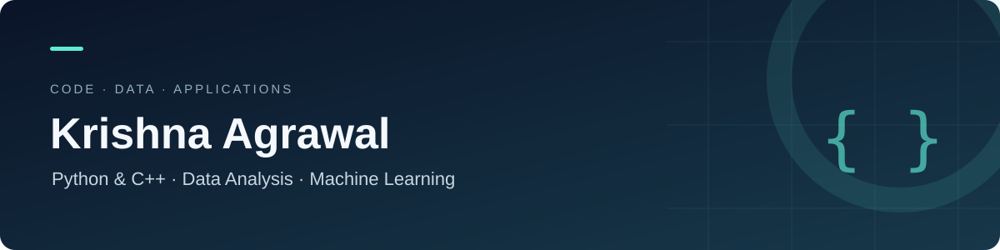

  

  <a href="#selected-projects">Selected projects</a> ·
  <a href="#learning-in-public">Learning in public</a> ·
  <a href="#technical-focus">Technical focus</a>

## Hi, I'm Krishna

I build projects with Python and practice data structures and algorithms in C++. My work explores how data moves through an application: from input and preprocessing to a model, a visualization, or a result someone can inspect.

I learn by implementing the steps, keeping them visible, and improving the project as I understand its tradeoffs.

## Selected projects

| Project | What I built | Explore |
| :--- | :--- | :--- |
| **Fog Visibility & Vehicle Detection** | A Streamlit workflow for image/video vehicle detection, image-feature scoring, and a visibility-classification experiment | [Source & walkthrough](https://github.com/krishna-ai-cpp/Fog-detection-system) |
| **IBDE · Intelligent Business Decision Engine** | A FastAPI application connecting CSV upload, preprocessing, ML workflows, visualizations, and a browser dashboard | [Source & architecture](https://github.com/krishna-ai-cpp/IBDE-Intelligent---Business--Decision--Engine-) |
| **Decision Intelligence Platform** | A Flask/MySQL application that guides a dataset through preparation, model comparison, decision-support views, and reporting | [Source & setup](https://github.com/krishna-ai-cpp/Decision-Intelligence-Platform) |

IBDE and Decision Intelligence Platform are separate projects: the first uses FastAPI and local model artifacts; the second uses Flask, account sessions, and MySQL records.

## Learning in public

| Repository | Focus | Good starting point |
| :--- | :--- | :--- |
| [C++ & DSA](https://github.com/krishna-ai-cpp/learning-cpp) | STL, recursion, backtracking, linked lists, and OOP console programs | [LRU cache](https://github.com/krishna-ai-cpp/learning-cpp/blob/main/lru_cache.cpp) |
| [Python & AI Lab](https://github.com/krishna-ai-cpp/python-ai-lab) | Python fundamentals, NumPy, data analysis, scikit-learn, and TensorFlow CNNs | [Analytics Insights Studio](https://github.com/krishna-ai-cpp/python-ai-lab/blob/main/smart_analytics_insights_studio.py) |

## Technical focus

- **Programming:** Python, C++, and SQL.
- **Data & ML:** NumPy, pandas, scikit-learn, TensorFlow/Keras, Matplotlib, and Seaborn.
- **Computer vision:** OpenCV and pretrained YOLOv8 detection.
- **Applications:** FastAPI, Flask, Streamlit, MySQL, Jinja2, HTML/CSS, and JavaScript.
- **Version control:** Git and GitHub.

## How to explore my work

Start with a project README for the problem, local setup, and source map. Open the linked implementation to follow the logic, then use the commit history to see how the work developed. Each project also states its current limitations and areas I want to improve.

[Browse all repositories](https://github.com/krishna-ai-cpp?tab=repositories) · [View contribution activity](https://github.com/krishna-ai-cpp#js-contribution-activity-description)
